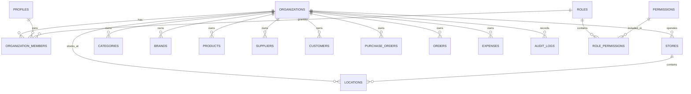
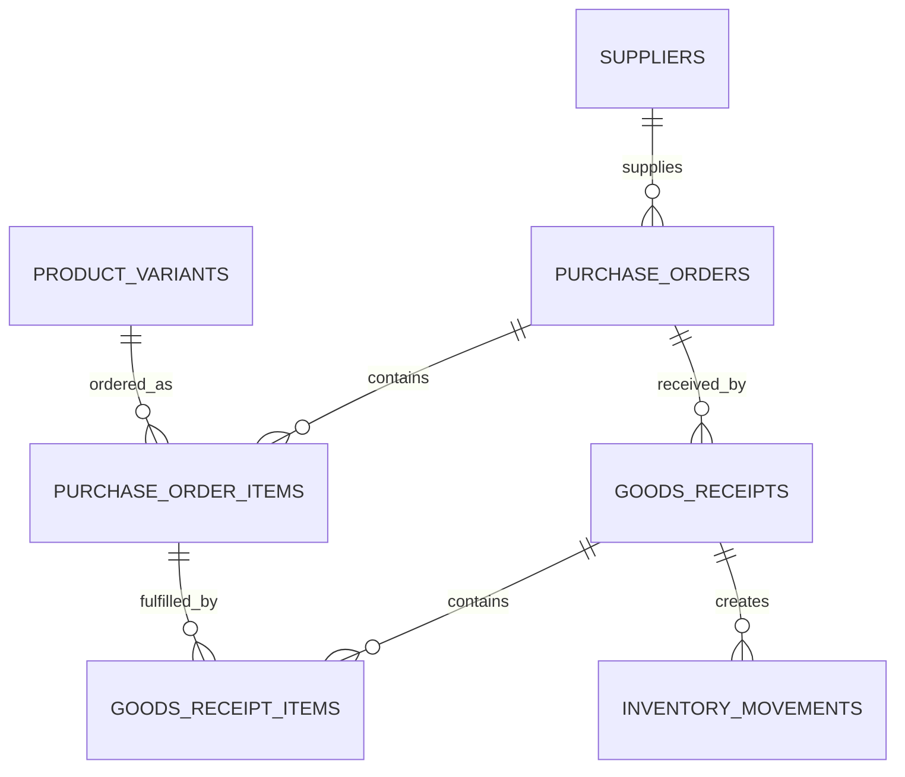
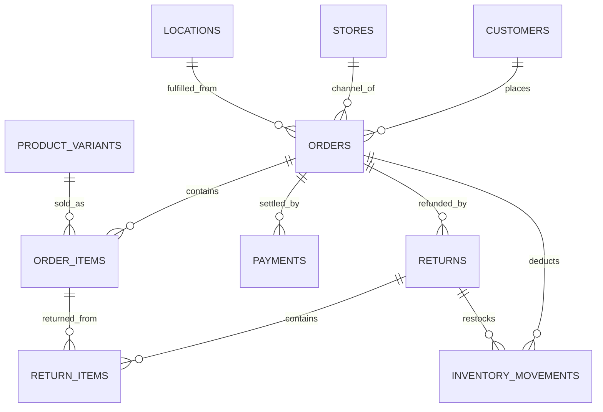
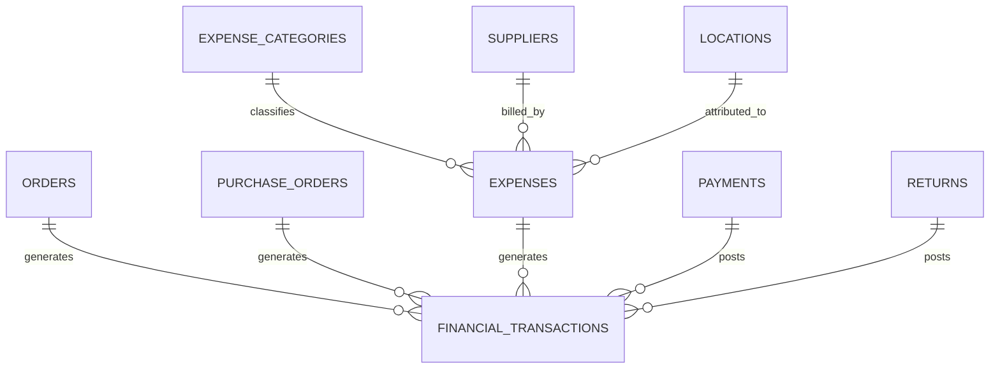
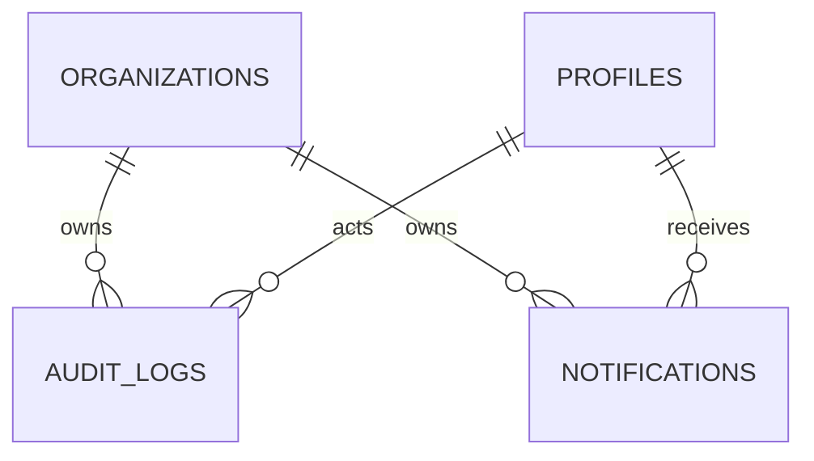

# Database Relationships

This is the relationship view of `docs/database/schema.md`. Cardinalities are
declared with the intent the migrations must enforce.

## 1. Tenancy



A user reaches business data only through `organization_members`. `profiles` is
the exposed projection of `auth.users`.

## 2. Catalogue and stock

```mermaid
erDiagram
    CATEGORIES ||--o{ PRODUCTS : classifies
    CATEGORIES ||--o{ CATEGORIES : parent_of
    BRANDS ||--o{ PRODUCTS : brands
    PRODUCTS ||--o{ PRODUCT_VARIANTS : has
    PRODUCT_VARIANTS ||--o{ INVENTORY_BALANCES : counted_at
    LOCATIONS ||--o{ INVENTORY_BALANCES : holds
    PRODUCT_VARIANTS ||--o{ INVENTORY_MOVEMENTS : moves
    LOCATIONS ||--o{ INVENTORY_MOVEMENTS : at
    STOCK_TRANSFERS ||--o{ INVENTORY_MOVEMENTS : produces
    STOCK_TRANSFERS }o--|| LOCATIONS : from
    STOCK_TRANSFERS }o--|| LOCATIONS : to
```

`inventory_balances` is unique per `(location_id, variant_id)`. Every balance
change writes an `inventory_movements` row in the same transaction; a transfer
writes an out leg and an in leg sharing `transfer_id`.

## 3. Purchasing



Receiving is the only path from purchasing to stock. A purchase order in `draft`
or `submitted` has no inventory effect.

## 4. Sales and returns



Orders store three channel values (`shop`, `van`, `online`) so future POS, van
and storefront clients write to the same table. A return that is restocked
creates a `customer_return` movement; a non-restock return records the refund
without adding stock.

## 5. Money and finance



Financial rows are append-only and always point at their source document. The
P&L views aggregate `financial_transactions` and snapshotted line costs; no
report recalculates money from floats.

## 6. Audit and notifications



`audit_logs` and `notifications` are written by triggers or server-side trusted
code. Clients have read-only access to audit logs (permission-gated); nothing
client-facing can update or delete either table.
